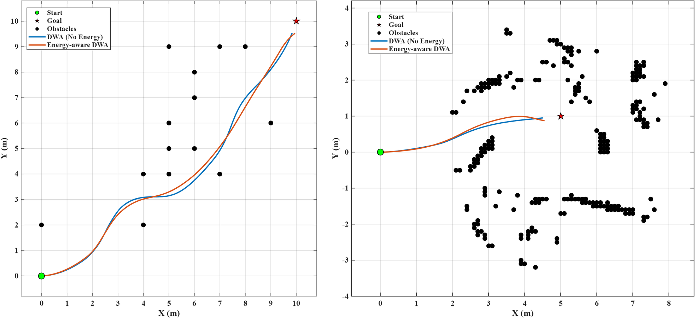

# Energy-Aware-DWA
### Energy-Aware Mobile Robot Path Planning Using Dynamic Window Approach

[](https://doi.org/10.1109/ICAC70325.2026.11712285)

MATLAB code for a Dynamic Window Approach (DWA) planner that adds a motor energy model to its cost function, so a differential-drive robot picks paths that use less energy and move more smoothly.

<p align="center">
  
</p>

*Classical DWA (blue) and energy-aware DWA (orange) on map 1 (left) and map 2 (right), as in Figs. 3a and 4a of the paper.*

## Overview

The DWA is a widely used local planner for mobile robots. At every step it tries a set of velocity commands and picks the one that best balances heading toward the goal, distance from obstacles and speed. It ignores how much energy each choice costs. This project adds an estimate of the drive motors' energy use to that choice:

| Component | What it does | Files |
|---|---|---|
| Energy model | Converts (v, ω) to wheel speeds and estimates motor power from friction torque and coil losses (eqs. 8–15) | `CalcEnergy` inside each planner |
| Classical DWA | Scores candidates on heading, clearance and velocity (eq. 7) | `classical_dwa.m` |
| Energy-aware DWA | Adds a weighted energy term to the score (eq. 16) | `energy_aware_dwa.m` |
| Sensitivity analysis | Raises one weight at a time to 0.9 on map 3 (Fig. 5, Table IV) | `sensitivity_analysis.m` |
| Maps and plots | Test environments and the comparison figures | `get_map.m`, `plot_comparison.m`, `plot_sensitivity.m` |

## How it works

1. The robot is a differential-drive platform with a forward-Euler motion model (eq. 2) and a 0.1 s time step.
2. Every step, the DWA samples (v, ω) pairs inside the dynamic window (up to 0.5 m/s and 180°/s) and predicts each one 3 s ahead.
3. Candidates whose predicted path comes within 0.2 m of an obstacle are rejected. The rest are scored on heading, clearance and speed.
4. The energy-aware planner also estimates each candidate's energy: wheel speeds → friction torque → coil current → electrical power. The energy is expressed per metre travelled, and lower energy gives a higher score.
5. The best candidate is applied for one step, and the loop repeats until the robot is within 0.5 m of the goal.

## Results

Classical vs. energy-aware DWA with α = β = γ = δ = 0.5 (Table III of the paper):

- Total energy drops by 3.6% on map 1 and 8.6% on map 2, compared with the classical DWA (see Known limitations).
- Average power goes up, but the robot finishes sooner, so total energy goes down.

Weight sensitivity on map 3, one weight raised to 0.9 (Table IV of the paper):

- Every case with the energy term moves much more smoothly than the case without it.
- α = 0.9 gives the shortest path, the lowest energy and the smoothest motion.
- Raising δ to 0.9 does not lower the energy further than δ = 0.5.


## Getting started

### 1. Requirements

- MATLAB (no toolboxes needed)

### 2. Install

```bash
git clone https://github.com/Ali-M-Mustafa/Energy-Aware-DWA.git
cd Energy-Aware-DWA/src
```

Run all scripts from inside `src/`.

### 3. Reproduce Table III

```matlab
classical_dwa(1);  energy_aware_dwa(1);  plot_comparison(1)   % map 1 (Fig. 3)
classical_dwa(2);  energy_aware_dwa(2);  plot_comparison(2)   % map 2 (Fig. 4)
```

### 4. Reproduce Table IV

```matlab
sensitivity_analysis          % runs all six weight settings on map 3
plot_sensitivity              % Fig. 5: trajectories and velocity profiles
```

To run a single setting, use for example `sensitivity_analysis('alpha09')`. The settings are `'delta0'`, `'equal'`, `'alpha09'`, `'beta09'`, `'gamma09'` and `'delta09'`.

### 5. Turn off the energy term (optional)

```matlab
energy_aware_dwa(1, 0)        % energy-aware planner with delta = 0
```

## Repository structure

```
Energy-Aware-DWA/
├── src/
│   ├── classical_dwa.m           # Classical DWA baseline (Table III)
│   ├── energy_aware_dwa.m        # Energy-aware DWA, eq. 16 (Table III)
│   ├── sensitivity_analysis.m    # Weight sensitivity on map 3 (Table IV)
│   ├── get_map.m                 # The three test maps, start and goal points
│   ├── plot_comparison.m         # Path and energy figures (Figs. 3–4)
│   └── plot_sensitivity.m        # Trajectory and velocity figures (Fig. 5)
├── path_comparison.png
├── LICENSE
├── README.md
└── .gitignore
```

## Known limitations

- **Table III does not isolate the energy term.** The classical and energy-aware scripts also differ in how clearance is measured (end point vs. the whole predicted path), in their collision check and in how scores are normalised. Running the energy-aware script with δ = 0 gives a fair baseline: the energy term alone saves 1.1% on map 1 (999.90 → 989.11 J) and 7.5% on map 2 (354.64 → 328.04 J). Table IV is a fair comparison, since only the weights change.
- **The energy cost is energy per metre (J/m)**, rather than the energy E(v, ω) written in eq. 16. The min-max normalisation of eq. 17 is applied to the energy term; the heading, clearance and velocity terms are divided by their maximum.
- **The braking constraint (eq. 5) is not implemented.** Unsafe candidates are rejected with a fixed 0.2 m clearance instead.
- **The energy model is steady-state.** It ignores acceleration, slopes and battery dynamics, and applies the full robot mass to each wheel's friction torque (as in eq. 11).
- **The classical baseline's collision check has a bug**: it moves the robot state forward across candidates instead of testing each one from the current position. It is kept so that Table III reproduces.

## Notes on reproduction

- Table II of the paper lists K_T = 0.02; the code uses 0.024, which rounds to it. The wheel radius and track width are not listed in the paper.
- The "elapsed time" columns in the paper are wall-clock times that include the animation, so they depend on the computer and are not repeated here.
- The scripts regenerate all data files, so none are included.

## Publication

If you use this code, please cite:

A. M. Mustafa and B. Brahmi, "Energy-Aware Mobile Robot Path Planning Using Dynamic Window Approach," in *2026 31st International Conference on Automation and Computing (ICAC)*, 2026, doi: 10.1109/ICAC70325.2026.11712285.

```bibtex
@inproceedings{mustafa2026energy,
  author    = {Mustafa, Ali M. and Brahmi, Brahim},
  title     = {Energy-Aware Mobile Robot Path Planning Using Dynamic Window Approach},
  booktitle = {2026 31st International Conference on Automation and Computing (ICAC)},
  year      = {2026},
  publisher = {IEEE},
  doi       = {10.1109/ICAC70325.2026.11712285}
}
```

## License

The project code is released under the [MIT License](LICENSE).

Credits:
- The planners are adapted from `DynamicWindowApproachSample.m` in Atsushi Sakai's [MATLABRobotics](https://github.com/AtsushiSakai/MATLABRobotics), Copyright (c) 2014 Atsushi Sakai.
- The energy model follows M. Yao et al., "Improved dynamic windows approach based on energy consumption management and fuzzy logic control for local path planning of mobile robots," *Computers & Industrial Engineering*, vol. 187, p. 109767, 2024.
- The Dynamic Window Approach is from D. Fox, W. Burgard and S. Thrun, "The Dynamic Window Approach to Collision Avoidance," *IEEE Robotics & Automation Magazine*, vol. 4, no. 1, pp. 23–33, 1997.
